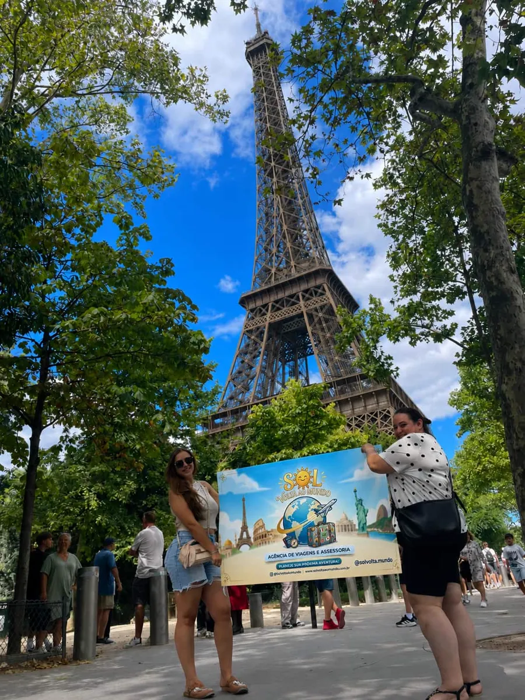

# Sol Volta ao Mundo ✈️

Site da **Sol Volta ao Mundo**, agência de viagens e assessoria da Solange, com atendimento no Brasil e em Portugal.

> *O mundo espera por si!*

Passagens nacionais e internacionais, pacotes e excursões, imigração com segurança, suporte com documentação e atendimento VIP. Todo contato acontece pelo WhatsApp, com mensagem pronta.



---

## Destaques

| Seção | O que faz |
|---|---|
| **Abertura** | Foto da equipe em Paris com o céu recortado: a palavra "MUNDO" fica atrás da Torre Eiffel. Sol, nuvens e avião se movem com a rolagem e o mouse. Painel de aeroporto troca os destinos letra por letra. |
| **Rotas** | Globo 3D interativo (arraste para girar) e painel de partidas. A pessoa escolhe sair do Brasil ou de Portugal, clica num destino e o globo desenha o voo. |
| **Serviços** | Etiquetas de mala numa esteira horizontal. Cada etiqueta abre o WhatsApp já falando do serviço escolhido. |
| **Documentação** | Passaporte com checklist por motivo da viagem (turismo, morar em Portugal, estudar ou trabalhar). Cada item marcado ganha um carimbo, e o botão envia à Solange o que já está pronto e o que falta. |
| **Cotação** | Cartão de embarque para preencher. Gera a mensagem no WhatsApp com origem, destino, datas, passageiros, classe e interesse. |
| **A Solange** | Foto em polaroid e um "como funciona" com um avião que segue a rolagem. |
| **Contato** | WhatsApp do Brasil e de Portugal, Instagram e botão flutuante. |

O site funciona no celular, e as animações são reduzidas quando o aparelho pede movimento reduzido.

---

## Estrutura

```
sol/
├── index.html          # página única
├── css/
│   └── style.css       # estilos e cores da marca
├── js/
│   └── main.js         # interações, globo, cotação e links do WhatsApp
└── assets/
    ├── paris-cutout.webp     # foto de Paris sem o céu (desktop)
    ├── paris-cutout-m.webp   # mesma foto, versão para celular
    ├── paris.webp            # foto original, usada na polaroid
    ├── paris-original.jpg    # foto original em alta, fonte das versões acima
    ├── logo-original.jpg     # logo
    └── favicon.png
```

HTML, CSS e JavaScript puros: não precisa instalar nada nem rodar build.

---

## Como rodar localmente

Abra o `index.html` no navegador ou, de preferência, sirva a pasta com um servidor local:

```bash
npx serve .
```

ou

```bash
python -m http.server 8000
```

> O globo carrega o mapa do mundo pela internet (d3 e world-atlas via CDN). Sem conexão, aparece uma esfera simples e o resto do site continua funcionando.

---

## Publicar no GitHub Pages

1. Envie os arquivos para o repositório.
2. Vá em **Settings → Pages**.
3. Em **Source**, escolha a branch `main` e a pasta `/ (root)`.
4. Salve. O site fica disponível em `https://marcosjaco.github.io/sol/`.

---

## Personalizar

**Números do WhatsApp**: ficam no começo de [`js/main.js`](js/main.js):

```js
const PHONES = { br: '556294889374', pt: '351961425870' };
```

Use só números, com o código do país e sem `+`, espaços ou traços. Os números exibidos na tela estão em [`index.html`](index.html) (procure por `+55` e `+351`).

**Mensagens prontas**: também em `js/main.js`, nas constantes `MSG_GENERAL` e `msgService` e nas funções da cotação e da documentação.

**Cores e fontes**: variáveis no topo de [`css/style.css`](css/style.css):

```css
--navy-800: #0A1F4D;   /* azul da marca */
--gold: #F6B81A;       /* amarelo do sol */
--paper: #FBF6EC;      /* fundo creme */
```

**Destinos do globo**: lista `DESTS` em `js/main.js`, com nome, país, código do aeroporto e coordenadas.

---

## Tecnologias

- HTML5, CSS3 e JavaScript (sem framework)
- [d3](https://d3js.org/) e [topojson-client](https://github.com/topojson/topojson-client) para o globo
- [world-atlas](https://github.com/topojson/world-atlas) para o mapa
- Fontes do Google Fonts: Bricolage Grotesque, Manrope, JetBrains Mono e Caveat

---

## Contato

- 🇧🇷 WhatsApp Brasil: [+55 (62) 9488-9374](https://wa.me/556294889374)
- 🇵🇹 WhatsApp Portugal: [+351 961 425 870](https://wa.me/351961425870)
- 📷 Instagram: [@sol.voltaaomundo](https://www.instagram.com/sol.voltaaomundo/)

**Solange, sua parceira em todas as viagens.** 🌍
